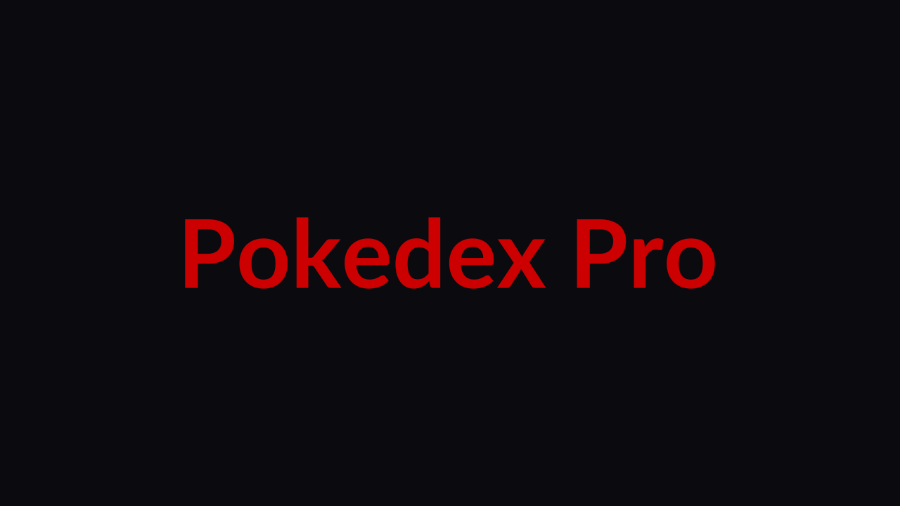

# Pokédex Pro

Pokédex Pro es una Pokédex web en español, instalable como PWA y diseñada para escritorio y dispositivos móviles. Permite consultar información completa de Pokémon, trabajar con favoritos y equipos, estudiar enfrentamientos de tipos y acceder a herramientas opcionales impulsadas por Google Gemini.

Los datos proceden de [PokéAPI](https://pokeapi.co/), se almacenan temporalmente en el navegador y se presentan en una interfaz con modos moderno y consola retro.



## Contenido

- [Características](#características)
- [Cómo funciona la aplicación](#cómo-funciona-la-aplicación)
- [Tecnologías y arquitectura](#tecnologías-y-arquitectura)
- [Requisitos](#requisitos)
- [Instalación](#instalación)
- [Configuración de Gemini](#configuración-de-gemini)
- [Scripts](#scripts)
- [PWA, caché y modo sin conexión](#pwa-caché-y-modo-sin-conexión)
- [Persistencia, privacidad y servicios externos](#persistencia-privacidad-y-servicios-externos)
- [Estructura del proyecto](#estructura-del-proyecto)
- [Pruebas](#pruebas)
- [Despliegue](#despliegue)
- [Limitaciones](#limitaciones)

## Características

### Explorar la Pokédex

- Catálogo con carga infinita en páginas de 20 Pokémon.
- Búsqueda por número, nombre completo o coincidencia parcial.
- Filtro por uno o dos tipos y por las nueve generaciones.
- Combinación de filtros de tipo mediante intersección: solo aparecen Pokémon que cumplen todos los tipos seleccionados.
- Orden por número o nombre, ascendente o descendente.
- Vista exclusiva de favoritos.
- Historial local de los últimos 20 Pokémon consultados, con acceso rápido a los ocho más recientes.
- Tarjetas con número, ilustración oficial, tipos y acceso rápido a favoritos.

### Ficha de cada Pokémon

- Ilustración normal y variocolor (*shiny*).
- Reproducción del grito disponible en PokéAPI.
- Nombre, número, tipos y distintivos de Pokémon legendario o singular.
- Descripción oficial en español con lectura mediante la síntesis de voz del navegador.
- Altura, peso, categoría, generación, ratio de captura y felicidad base.
- Habilidades traducidas al español e identificación de habilidades ocultas.
- Estadísticas base individuales y total acumulado.
- Fortalezas, debilidades, resistencias e inmunidades, incluidas las relaciones ×4 y ×0,25 de tipos dobles.
- Cadena evolutiva navegable con nivel, método u objeto cuando PokéAPI aporta esa información.
- Navegación entre formas y variedades alternativas.
- Acciones para añadir a favoritos, añadir o quitar del equipo y compartir mediante la API nativa del dispositivo o el portapapeles.

### Equipos y herramientas de combate

La sección **Juegos** agrupa cinco herramientas:

1. **Mi Equipo**: crea un equipo de hasta seis integrantes, evita repetir una especie, permite reordenar posiciones mediante arrastrar y soltar, eliminar miembros y vaciar el equipo.
2. **Aventura**: Gemini evalúa el equipo para diez juegos o regiones —Kanto, Johto, Hoenn, Sinnoh, Hisui, Teselia, Kalos, Alola, Galar y Paldea— y organiza el resultado en análisis general, líderes, Alto Mando y recomendaciones por Pokémon.
3. **Mis Equipos**: guarda hasta 20 composiciones con nombre y fecha, y permite cargarlas o eliminarlas.
4. **Rotom Dex / Analizador de Equipo**: resume cobertura ofensiva, debilidades compartidas y resistencias; también permite elegir un rival y pasar el enfrentamiento al comparador.
5. **Comparador**: enfrenta dos Pokémon y compara estadísticas base, habilidades y cobertura de tipos. Admite selección rápida desde el equipo propio o uno compartido.

Los equipos pueden compartirse como una URL con sus identificadores en el parámetro `team`. Quien abre el enlace puede revisar cada integrante, analizarlo, añadir miembros individuales o importar la formación completa después de confirmar el reemplazo del equipo actual.

### Funciones con inteligencia artificial

- **Escáner por cámara**: captura un fotograma e intenta identificar el Pokémon con la capacidad visual de Gemini; si lo reconoce, abre su ficha en PokéAPI.
- **Rotom Dex conversacional**: chat en español con historial durante la sesión y contexto del Pokémon, equipo o comparador que está utilizando el usuario.
- **Analizador de aventura**: genera recomendaciones contextualizadas para el equipo y el juego seleccionado.
- Selección automática de un modelo Gemini compatible disponible para la clave configurada.

Estas funciones son opcionales. La exploración, las fichas, los favoritos, la gestión de equipos, el cálculo de tipos y el comparador funcionan sin una clave de Gemini.

### Experiencia y personalización

- Tema claro u oscuro, inicialmente adaptado a la preferencia del sistema.
- Dos diseños: interfaz moderna y consola Pokédex retro.
- Reproductor de música lofi basado en YouTube, con reproducción, pausa, volumen, avance o retroceso y una URL o lista personalizada.
- Indicador de pérdida de conexión.
- Avisos de instalación y de nuevas versiones de la PWA.
- Estados de carga, vacío y error; imágenes diferidas y transiciones visuales cuando el navegador las soporta.

## Cómo funciona la aplicación

```text
Interfaz React
├── Explorar y fichas ────── PokéAPI
├── Cámara, chat y análisis ─ Google Gemini (opcional)
├── Música ───────────────── YouTube IFrame API (opcional)
├── Preferencias y equipos ─ localStorage
├── Datos estructurados ──── IndexedDB (TTL de 24 horas)
└── Recursos y respuestas ── Cache Storage / Service Worker
```

El estado global se divide en contextos para tema, ajustes, caché, favoritos/equipos, Pokémon seleccionado y contexto de Rotom. Los servicios aíslan el acceso a PokéAPI, Gemini, almacenamiento y funciones para compartir. No existe un servidor propio ni una base de datos remota del proyecto: la aplicación se ejecuta íntegramente en el navegador.

## Tecnologías y arquitectura

| Área | Tecnología |
| --- | --- |
| Interfaz | React 19, React DOM y TypeScript estricto |
| Desarrollo y compilación | Vite 5 |
| Datos Pokémon | PokéAPI |
| Inteligencia artificial | Google Generative AI SDK y Gemini API |
| Aplicación instalable | Web App Manifest y Service Worker |
| Persistencia | `localStorage`, IndexedDB y Cache Storage |
| Capacidades del dispositivo | MediaDevices, Web Share, Clipboard y Web Speech APIs |
| Pruebas | Vitest, jsdom y Testing Library |
| Estilos | CSS modular por componente, variables globales y diseño adaptable |

El alias `@/` apunta a `src/`. TypeScript está configurado en modo estricto, sin emisión de archivos y con destino ES2020. Vite separa React en un *chunk* propio y genera mapas de código para producción.

## Requisitos

- Node.js 18 o posterior.
- npm, utilizando el archivo de bloqueo incluido.
- Un navegador moderno con JavaScript habilitado.
- Conexión a Internet para la primera consulta de datos y para servicios externos.
- Opcional: una clave de Google Gemini API para el escáner, el chat y el análisis de aventura.
- Para usar la cámara: un dispositivo compatible, permiso del usuario y un contexto seguro (`https://` o `localhost`).

## Instalación

```bash
git clone https://github.com/JaviMejias/pokedex.git
cd pokedex
npm ci
npm run dev
```

El servidor de desarrollo queda disponible en `http://localhost:3000`, se abre automáticamente y acepta conexiones desde la red local.

## Configuración de Gemini

1. Crea una clave en [Google AI Studio](https://aistudio.google.com/app/apikey).
2. Abre el botón de **Ajustes** en la aplicación.
3. Pega la clave en la sección **Inteligencia Artificial (Gemini)** y guárdala.

También es posible introducirla desde el escáner o Rotom Dex. La aplicación conserva la clave localmente en el navegador y la utiliza directamente contra la API de Google; no hay un *backend* que la oculte.

> **Importante:** una aplicación puramente cliente no puede proteger un secreto. Usa una clave con restricciones y cuotas adecuadas, no la incluyas en el repositorio y no la compartas en capturas, registros o enlaces.

No se requieren archivos `.env` para ejecutar el proyecto actual.

## Scripts

| Comando | Descripción |
| --- | --- |
| `npm run dev` | Inicia Vite en modo desarrollo. |
| `npm run build` | Valida TypeScript y genera la compilación en `dist/`. |
| `npm run preview` | Sirve localmente el contenido compilado. |
| `npm test` | Ejecuta Vitest en modo observación. |
| `npm test -- --run` | Ejecuta toda la suite una vez. |
| `npm run test:ui` | Abre la interfaz de Vitest. |
| `npm run test:coverage` | Ejecuta las pruebas y genera cobertura en texto, JSON y HTML. |

## PWA, caché y modo sin conexión

Pokédex Pro incluye manifiesto, iconos, capturas y un Service Worker propio:

- Los recursos de la aplicación usan una estrategia **cache first**.
- Las imágenes de PokéAPI, jsDelivr y GitHub se guardan después del primer acceso.
- Las respuestas de PokéAPI usan **network first** con respaldo en caché.
- Los datos de Pokémon, especies, tipos y evoluciones también se guardan en IndexedDB durante 24 horas.
- Si una navegación falla sin conexión, se intenta recuperar el documento principal almacenado.
- La interfaz avisa cuando el navegador pasa a estado *offline* y cuando hay una actualización disponible.

El soporte sin conexión es parcial: solo estarán disponibles la aplicación y los recursos o datos consultados y almacenados anteriormente. Gemini, YouTube y cualquier contenido aún no visitado requieren conexión.

La opción **Recargar caché** de Ajustes elimina los registros del Service Worker y recarga la página para forzar una nueva instalación. Los datos personales conservados en `localStorage` no se eliminan con esa acción.

## Persistencia, privacidad y servicios externos

| Dato | Almacenamiento | Alcance |
| --- | --- | --- |
| Favoritos, equipo actual y hasta 20 equipos guardados | `localStorage` | Navegador y origen actuales |
| Historial de hasta 20 consultas | `localStorage` | Navegador y origen actuales |
| Tema, diseño, volumen y URL de YouTube | `localStorage` | Navegador y origen actuales |
| Clave de Gemini | `localStorage` | Navegador y origen actuales |
| Análisis de aventura por composición | `localStorage` | Navegador y origen actuales |
| Pokémon, especies, tipos y evoluciones | IndexedDB | Caché local de 24 horas |
| Aplicación, respuestas e imágenes visitadas | Cache Storage | Administrado por el Service Worker |

La aplicación se comunica directamente con estos servicios externos:

- **PokéAPI** para información, traducciones, sprites y evoluciones.
- **Google Gemini** para imágenes, conversación y análisis, solo cuando se utiliza una función de IA.
- **YouTube IFrame API** para el reproductor musical.
- **Google Fonts** para Orbitron e Inter.
- **GitHub/jsDelivr** como fuentes auxiliares de imágenes.

Las fotografías capturadas por el escáner se convierten en una imagen JPEG y se envían a Gemini para su identificación. Los equipos compartidos viajan en la propia URL; no contienen configuraciones ni la clave de API.

## Estructura del proyecto

```text
.
├── public/
│   ├── icons/                 Iconos y capturas de la PWA
│   ├── manifest.json          Metadatos de instalación
│   └── sw.js                  Estrategias de caché y actualización
├── src/
│   ├── components/            Interfaz reutilizable y ficha de Pokémon
│   ├── contexts/              Estado global y persistencia de usuario
│   ├── hooks/                 Cámara, PWA, conectividad, voz y utilidades
│   ├── i18n/                  Textos de interfaz en español
│   ├── services/              PokéAPI, Gemini, caché y uso compartido
│   ├── styles/                Tokens, estilos globales y animaciones
│   ├── tests/                 Pruebas unitarias
│   ├── types/                 Contratos TypeScript de dominio
│   ├── utils/                 Diccionarios, formatos y cálculos de tipos
│   ├── views/                 Explorar, Escáner y Juegos
│   ├── App.tsx                Composición de proveedores
│   └── main.tsx               Punto de entrada de React
├── index.html                 Documento base y metadatos sociales
├── package.json               Dependencias y scripts
├── tsconfig.json              Configuración de TypeScript
└── vite.config.ts             Desarrollo, compilación y pruebas
```

El archivo [ROADMAP.md](./ROADMAP.md) recoge ideas futuras y no debe interpretarse como funcionalidad ya disponible.

## Pruebas

La suite actual valida:

- Diccionarios de tipos, estadísticas, generaciones y versiones.
- Formato de identificadores, alturas, pesos y descripciones.
- Extracción de identificadores desde URL y porcentajes de estadísticas.
- Cálculo de debilidades, resistencias, inmunidades y multiplicadores para tipos simples y dobles.

Ejecución completa:

```bash
npm test -- --run
npm run build
```

## Despliegue

```bash
npm run build
npm run preview
```

La salida estática se genera en `dist/` y puede publicarse en cualquier alojamiento HTTPS preparado para aplicaciones de una sola página.

La configuración actual registra `/sw.js` y referencia el manifiesto, los iconos y las capturas mediante rutas absolutas. Por tanto, la aplicación debe desplegarse en la raíz del dominio. Si se publica bajo un subdirectorio, es necesario ajustar la base de Vite y las rutas públicas del HTML, manifiesto, Service Worker y servicios para compartir.

## Limitaciones

- Los resultados de Gemini pueden ser incorrectos y no sustituyen fuentes oficiales ni herramientas competitivas especializadas.
- El escáner depende de la calidad de la imagen, la cámara, la iluminación, la conectividad y el modelo disponible para la clave.
- La síntesis de voz y las opciones de instalación o uso compartido varían según el navegador y el sistema operativo.
- Los datos personales y equipos no se sincronizan entre navegadores o dispositivos.
- Borrar los datos del sitio elimina preferencias, favoritos, equipos, historial, clave y cachés locales.
- La disponibilidad de datos y recursos externos depende de sus respectivos proveedores.

## Aviso legal

Este es un proyecto no oficial y sin afiliación con Nintendo, Game Freak, Creatures Inc. ni The Pokémon Company. Pokémon y sus marcas relacionadas pertenecen a sus respectivos propietarios. Los datos se obtienen de PokéAPI y las respuestas generadas por IA pueden contener errores.
